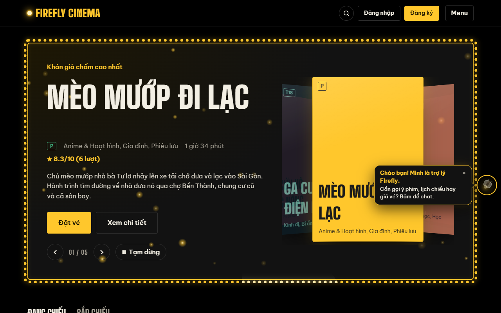
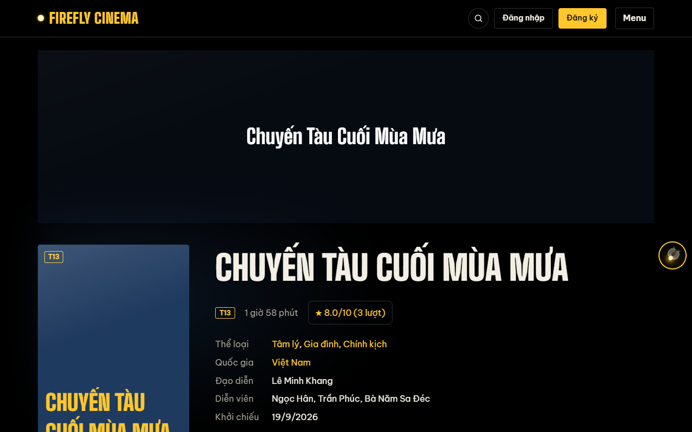
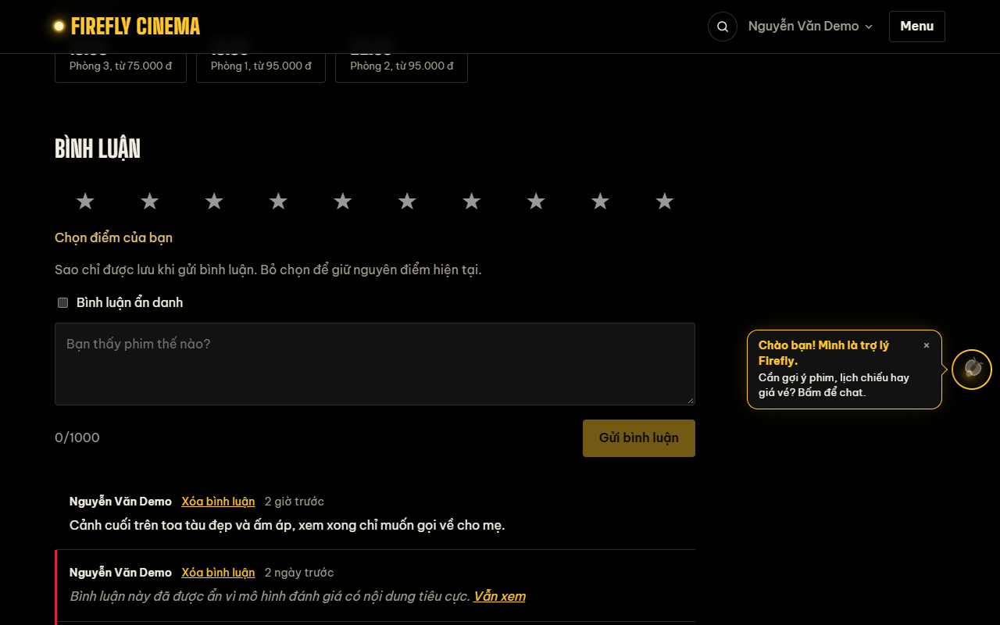
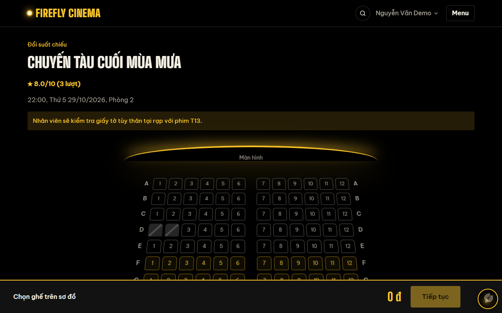
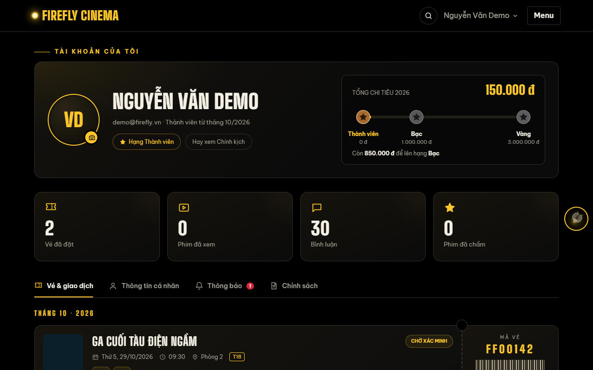
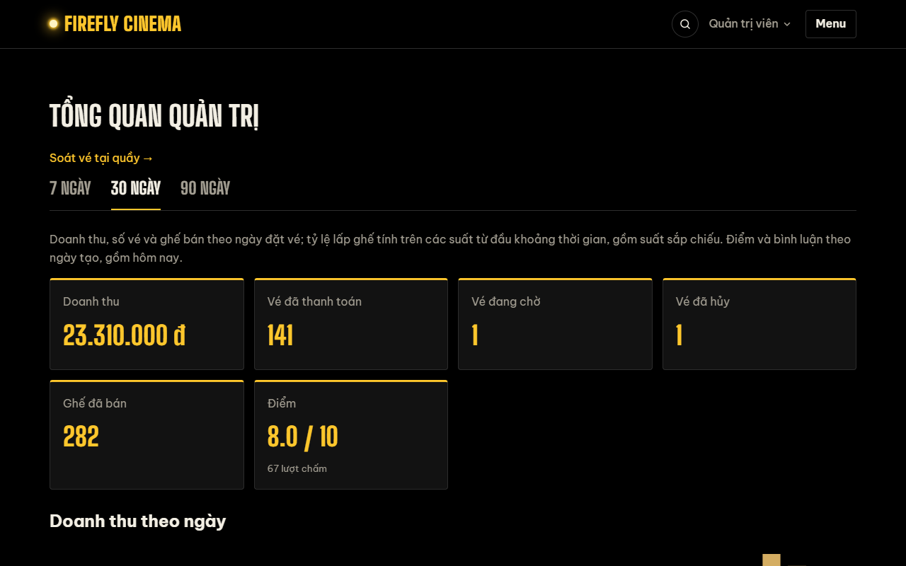
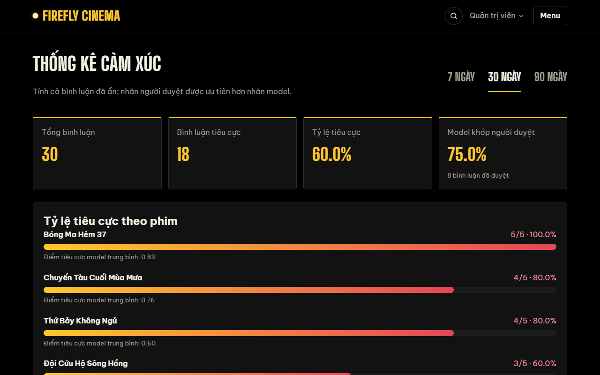
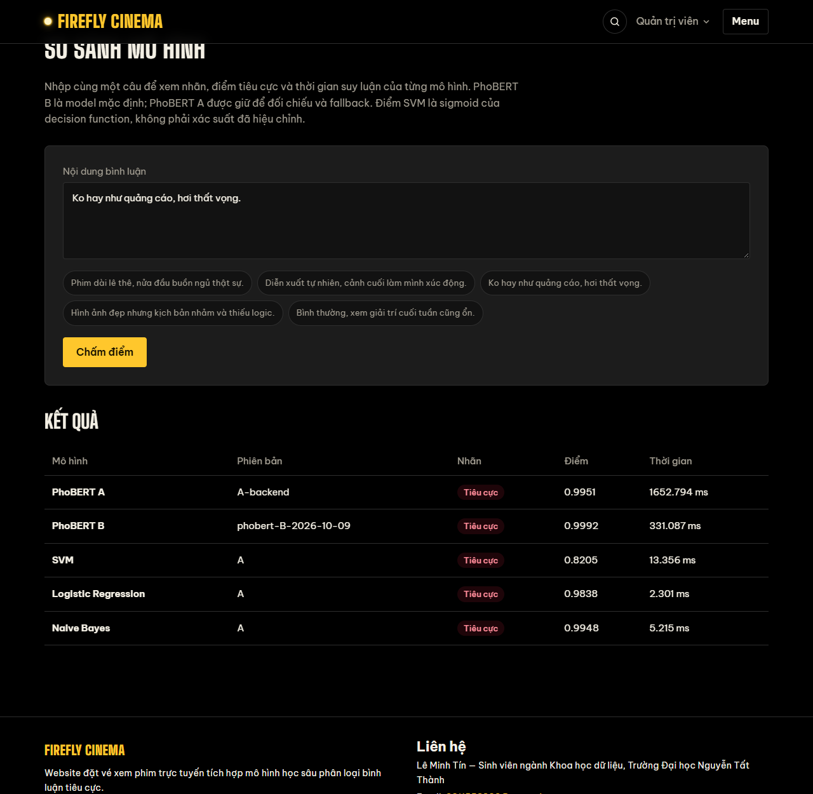
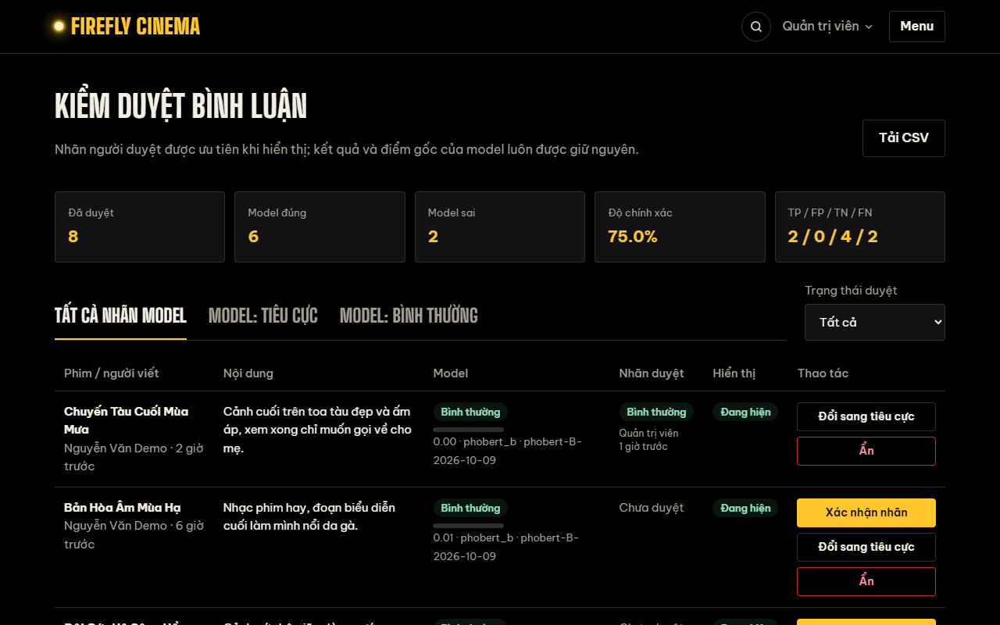

# Firefly Cinema

Website đặt vé xem phim tích hợp **PhoBERT phân loại bình luận tiêu cực**, so sánh với các mô hình truyền thống (SVM, Logistic Regression, Naive Bayes). Khóa luận tốt nghiệp ngành Khoa học dữ liệu, Trường Đại học Nguyễn Tất Thành.

**Phiên bản 1.0** (29/10/2026). **Xem thử giao diện:** https://mtin2107.github.io/firefly-cinema/ (bản mock: dữ liệu mẫu lưu trong trình duyệt, không có backend và PhoBERT).



## Tính năng

**Khách xem phim**
- Trang chủ có banner phim nổi bật, danh sách đang chiếu / sắp chiếu, bộ sưu tập (hot tuần, hot tháng, nhiều bình luận, đánh giá cao); lọc theo thể loại, quốc gia, năm, chủ đề; tìm kiếm không dấu.
- Chi tiết phim: nội dung, trailer (YouTube hoặc video tải lên), điểm 1–10 kèm phân bố, bình luận (có ẩn danh).
- Đặt vé: chọn suất, sơ đồ 8 × 12 ghế (VIP hàng F–H), giữ chỗ có hạn, thanh toán chuyển khoản qua mã VietQR, hủy vé; Vé của tôi; vé có mã và mã vạch.
- Tài khoản: hồ sơ, ảnh đại diện, đổi email/mật khẩu, hạng thành viên theo chi tiêu, kiểm tra độ tuổi theo phân loại phim.
- Trợ lý AI tư vấn phim (Gemini qua API tương thích OpenAI, tùy chọn, chỉ dùng local).

**Bình luận và mô hình**
- Mỗi bình luận mới được PhoBERT B chấm ngay; điểm tiêu cực ≥ 0,5 thì tự ẩn (người xem vẫn bấm "Vẫn xem" được).
- Kiểm duyệt có người duyệt: admin xác nhận hoặc đổi nhãn, nhãn người duyệt được ưu tiên, kết quả gốc của model luôn giữ lại; thống kê TP/FP/TN/FN; xuất CSV an toàn.
- So sánh mô hình: nhập một câu, xem nhãn, điểm và thời gian suy luận của PhoBERT A, PhoBERT B, SVM, LR, NB.
- Thống kê cảm xúc theo 7/30/90 ngày, theo phim và theo ngày.

**Quản trị**
- Tổng quan kinh doanh (doanh thu, vé, lấp ghế, điểm), quản lý phim (poster và trailer tải từ máy), suất chiếu (chặn trùng phòng), vé (xác nhận chuyển khoản), soát vé tại rạp.

| | |
|---|---|
|  |  |
|  |  |
|  |  |
|  |  |

Toàn bộ 14 ảnh: [`docs/images/`](docs/images/).

## Kết quả mô hình

Nhãn nhị phân: bình luận **tiêu cực** / không tiêu cực. Hai tập test: **phone** (UIT-ViSFD, bình luận điện thoại) và **movie** (149 câu bình luận phim tự thu thập, 67,8 % tiêu cực). Nguồn: `ml/model_card_B.md`, `ml/results/comparison_B.csv`.

| Mô hình | F1 tiêu cực (phone) | Macro-F1 (phone) | F1 tiêu cực (movie) | Macro-F1 (movie) |
|---|---:|---:|---:|---:|
| **PhoBERT B** (dùng trên web) | 0,9172 | 0,9018 | **0,9175** | **0,8818** |
| PhoBERT A | **0,9199** | **0,9087** | 0,8571 | 0,8165 |
| SVM A | 0,8938 | 0,8779 | 0,8134 | 0,6876 |
| Logistic Regression A | 0,8931 | 0,8769 | 0,8152 | 0,6834 |
| Naive Bayes A | 0,8776 | 0,8614 | 0,8057 | 0,6672 |
| Hằng số "tiêu cực" (mốc so sánh) | 0,7170 | 0,3585 | 0,8080 | 0,4040 |

- A: train trên dữ liệu điện thoại; B: thêm dữ liệu phim. PhoBERT B tăng F1 tiêu cực trên movie từ 0,857 lên 0,918 (giảm lệch miền), đổi lại thấp hơn A 0,0028 trên phone.
- Movie test lệch nhãn: mô hình đoán hằng "tiêu cực" đã có F1 tiêu cực 0,808, nên phải đọc cùng macro-F1.
- **Tách từ (T15):** cùng recipe, bản có tách từ thấp hơn: movie F1 tiêu cực 0,8649 so với 0,8854 không tách từ; phone 0,9195 so với 0,9233; tốn thêm ~1,7 ms/câu. Web giữ bản không tách từ. Nguồn: `ml/model_card_A.md`, `ml/results/word_segment.csv`.

## Chạy nhanh (Windows)

Yêu cầu: Python 3.13, Node 24, Git. Cài đặt đầy đủ từ số 0, gắn model và cấu hình `.env`: [`HUONG_DAN.md`](HUONG_DAN.md#cài-đặt-từ-số-0-v10).

```powershell
cd backend
python -m venv venv
venv\Scripts\Activate.ps1
pip install torch==2.11.0 --index-url https://download.pytorch.org/whl/cpu
pip install -r requirements-ml.txt -r requirements-dev.txt
copy .env.example .env   # rồi điền SECRET_KEY, ADMIN_PASSWORD
uvicorn app.main:app --port 8000
```

```powershell
cd frontend
copy .env.example .env    # VITE_USE_MOCK=false, VITE_API_URL=http://localhost:8000
npm install
npm run dev               # http://localhost:5173
```

Sau khi đã cài: `chay-firefly.bat` mở cả backend và frontend; `reset-demo.bat` đặt lại dữ liệu demo. `http://localhost:8000/api/health` phải báo `"classifier":"phobert_b"`. Chưa có model thì backend tự dùng bộ lọc từ khóa.

Tài khoản mẫu: `demo@firefly.vn` / `123456`; admin `admin@firefly.vn` với mật khẩu đặt ở `ADMIN_PASSWORD`.

## Cấu trúc

```
frontend/   React + Vite (src/api: real.js và mock.js cùng cấu trúc JSON)
backend/    FastAPI + SQLAlchemy + SQLite; app/classifier.py nạp PhoBERT và mô hình sklearn
ml/         Notebook, mã train/đánh giá, model card, kết quả
docs/       Kiến trúc, công nghệ, kịch bản demo, sao lưu, task record
```

Tài liệu: [`docs/ARCHITECTURE.md`](docs/ARCHITECTURE.md), [`docs/CONG_NGHE.md`](docs/CONG_NGHE.md), [`docs/KICH_BAN_DEMO.md`](docs/KICH_BAN_DEMO.md), [`docs/SAO_LUU.md`](docs/SAO_LUU.md), [`CHANGELOG.md`](CHANGELOG.md).

## Hạn chế đã biết (v1.0)

**Phạm vi triển khai**
- Bản v1.0 dành cho chạy local và demo. Chưa được phép triển khai thật: DB thật/triển khai (T16 TODO-01) và chatbot Gemini (T17, chỉ MVP/local) còn hiệu lực.
- Giới hạn tối đa 2 vé đang giữ cho mỗi người chỉ đảm bảo khi chạy **một** worker uvicorn (khóa trong tiến trình, T30).
- Không có migration: đổi schema phải sao lưu và tạo lại `firefly.db`.

**Mô hình**
- PhoBERT B vẫn nhầm một số câu khen thành tiêu cực, ví dụ một bình luận khen ở phim mở đầu kịch bản demo (T12 TODO-01, T22). Đây là ví dụ về lệch miền; admin đổi nhãn được ở trang Kiểm duyệt.
- Độ khớp model ở trang Thống kê tính theo cửa sổ ngày, ở trang Kiểm duyệt tính trên toàn bộ, nên hai con số có thể khác nhau (đúng thiết kế).

**Nghiệp vụ**
- Vé chờ xác nhận chuyển khoản không tự hết hạn; admin vẫn xác nhận được sau giờ chiếu.
- Soát vé không chặn theo ngày/giờ suất chiếu.
- Tài khoản chưa khai ngày sinh vẫn đặt được phim giới hạn tuổi; nhân viên kiểm giấy tờ tại rạp.
- Đổi mật khẩu/email không thu hồi token đăng nhập cũ (token hết hạn sau 24 giờ).
- Đổi email không xác minh qua thư; admin dùng chung một tài khoản.
- Ai đăng nhập cũng chấm điểm phim được, không cần đã xem.

**Trailer, ảnh và giao diện**
- Thay/gỡ video trailer không xóa file cũ trong `backend/uploads/trailers/`; trailer YouTube cần mạng; video tải lên ở chế độ mock mất khi tải lại trang.
- Tạo phim không bắt buộc poster (dùng poster màu tự vẽ). Menu đầy đủ chỉ hiện từ 1361 px, hẹp hơn thì gom vào nút Menu. Tiêu đề dùng line-height 1,35.
- Ở điện thoại (≤ 420 px) khi **chưa đăng nhập**, header xuống 2 hàng (logo một hàng, nút Đăng nhập/Đăng ký/Menu một hàng).
- Chế độ mock có ít dữ liệu hơn backend thật (cùng cấu trúc JSON, khác con số).
