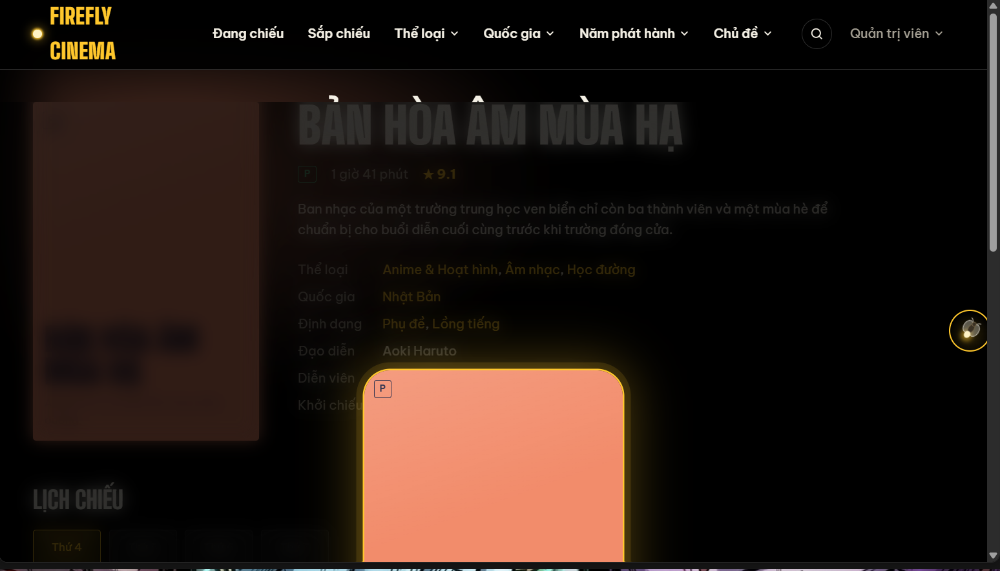
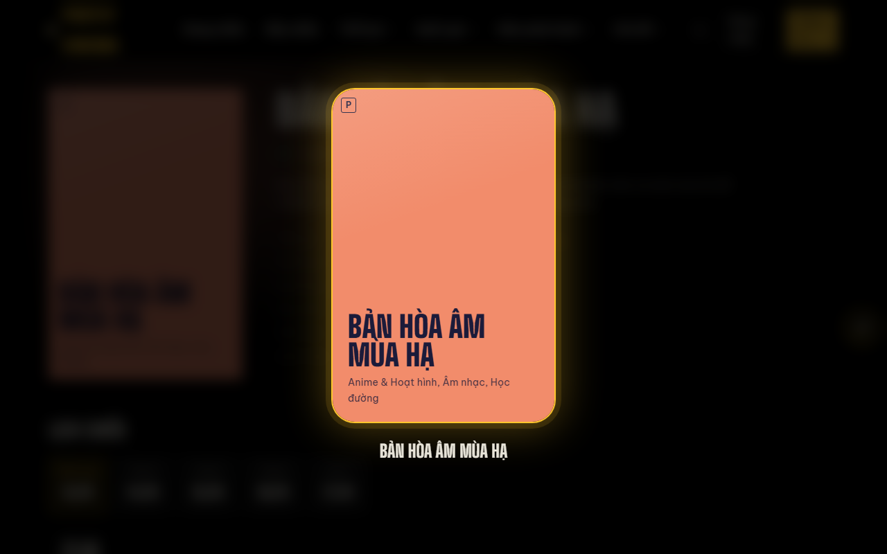
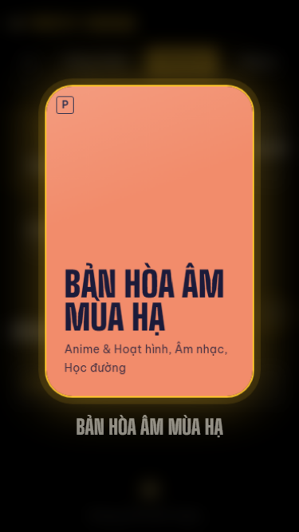

# Codex Independent Review — T18 Round 3 — PASS_WITH_TODO

| Trường | Giá trị |
|---|---|
| Task | T18 — Chuyển động và hiệu ứng 3D |
| Nhánh | `task/T18-giao-dien-chuyen-dong` |
| Baseline | `master` tại `fdaa7acc0f2ff71d3ff99ee47d92eedde32fa283` |
| Delta Round 3 | `bf05ad6..490ac8a` |
| HEAD trước RF-04 | `7f6a0c239cf4d8a7d023ae30ac2cb34d9cdcb28d` |
| Fix RF-04 | `490ac8aeaf2ebcb41c38b8226a596b3958235479` |
| Reviewer / Fix implementer | Codex |
| Ngày | 13/10/2026 |
| Kết luận | **PASS_WITH_TODO** |

## 1. Kết luận

RF-04 đã được sửa đúng phạm vi bằng `createPortal(..., document.body)` từ `react-dom` có sẵn. Không sửa hiệu ứng `route-fade`, không thêm dependency và không đổi thời gian/hành vi click/Esc/reduced-motion của PosterIntro.

Review lại toàn bộ delta Round 3 không phát hiện Required Fix mới. AC-01 đến AC-11 đạt **11/11 PASS** theo Task Record đã được PO sửa (M4 poster flight đã hủy, PosterIntro gốc được khôi phục). RF-01 đến RF-04 đều **CLOSED / VERIFIED BY CODEX**. Giữ nguyên TODO-01 đến TODO-03 để PO disposition.

## 2. RF-04 — CLOSED / VERIFIED BY CODEX

**Severity:** Medium

**File:** `frontend/src/components/PosterIntro.jsx`

**Nguyên nhân:** `.route-fade` giữ `transform` từ animation `route-in`; phần tử con `position: fixed` vì vậy lấy `.route-fade` làm containing block thay vì viewport.

**Fix:** import `createPortal` từ `react-dom` và portal lớp `.intro` trực tiếp vào `document.body`. Fix commit chỉ đổi 1 file, 4 dòng thêm/2 dòng sửa.

### Bằng chứng trình duyệt

| Ca kiểm | Kết quả độc lập |
|---|---|
| Hero “Xem chi tiết”, 1280×800, trang chủ đã cuộn `650px` | `.intro` là con trực tiếp của `BODY`; rect `0,0,1280,800`; backdrop hit-test phủ header; không nằm trong `.route-fade`. |
| Hero “Đặt vé”, 375×667, trang chủ đã cuộn `650px` | `.intro` là con trực tiếp của `BODY`; rect `0,0,375,667`; poster giữa viewport; backdrop phủ header; URL giữ `#lich-chieu`. |
| Bỏ qua | Click nền và phím Esc đều đóng sau fade; tự đóng sau chu kỳ gốc 1,8s + 0,6s. |
| Reload/direct URL | Không phát lại intro do navigation state đã được xóa; direct URL không có intro. |
| Reduced motion | Nếu media đang `reduce` khi điều hướng, intro được bỏ qua và chức năng điều hướng vẫn đủ. CSS chung vô hiệu hóa animation/transition. |
| Audit fixed descendant | Chỉ còn `.summary-bar` bên trong `.route-fade`; đây là trường hợp chủ đích đã có `.route-fade:has(.summary-bar)` dùng animation opacity-only. `.intro`, `.chat-widget`, `.chat-panel` đều ở ngoài `.route-fade`. |

## 3. Acceptance Criteria

| AC | Kết quả | Bằng chứng review Round 3 |
|---|---|---|
| AC-01 | **PASS** | Chỉ có `gsap@3.15.0` và `@gsap/react@2.1.2`, đều ghim chính xác. Build JS gzip `134,82 KB`; baseline Codex đã đo `85,29 KB`, tăng `49,53 KB` ≤ `60 KB`. RF-04 không thêm dependency. |
| AC-02 | **PASS** | Hero 5 phim; tự chuyển đúng một bước sau 6,4s; pause giữ qua focus và bấm Phim sau; reduced-motion dừng autoplay. Link CTA đúng phim; Ctrl-click mở `/phim/9` ở tab mới và tab gốc vẫn `/`. |
| AC-03 | **PASS** | Tilt/reveal không đổi trong delta Round 3; dynamic reduced-motion đưa 5/5 slot về `transform:none`. TODO-01 giữ nguyên. |
| AC-04 | **PASS** | Theo quyết định PO mới: PosterIntro gốc được giữ; poster/title/CTA hero và card vẫn là Link chuẩn, direct URL/reload không phát intro, hash lịch chiếu giữ đúng. RF-04 sửa positioning bằng portal. |
| AC-05 | **PASS** | Hit-test lại đủ `96/96` ghế ở 375px và `96/96` ở 1280px trong toàn bộ vùng cuộn. Chat không chồng nút Tiếp tục/tổng tiền; teaser không hiện ở route ghế; kéo không mở panel, click sau kéo mở được. |
| AC-06 | **PASS** | Delta Round 3 không đổi TicketStub; real/mock booking và Vé của tôi đạt, hành vi lật/in/reduced đã được kiểm ở Round 2. |
| AC-07 | **PASS** | Route/microinteraction/skeleton không hồi quy. Icon chat SVG đom đóm và teaser hoạt động; teaser một lần/phiên, tự ẩn, không hiện ở ghế/admin; 375px không tràn ngang. |
| AC-08 | **PASS** | Browser media emulation thật sau mount: `no-preference → reduce → no-preference`; canvas `1→0→1`, pause control `1→0→1`, 5/5 hero transform thành `none`, autoplay dừng; chức năng điều hướng/ghế còn đủ. PosterIntro bị bỏ qua khi điều hướng trong reduce. |
| AC-09 | **PASS** | Quan sát Home hơn 14 giây, console/page error 0. Có một long task 93ms tại `0,632s` trong startup/load; không có long task >50ms do animation lặp trong phần trace còn lại. Không thấy lỗi unmount/timer/RAF/tween. |
| AC-10 | **PASS** | 375/768/1280 đều `scrollWidth-innerWidth=0`; tiêu đề tiếng Việt đúng; nút hero có aria-label; focus/pause/keyboard từ Round 2 không hồi quy; PosterIntro đúng viewport ở mobile/desktop. |
| AC-11 | **PASS** | Regression real/mock đạt; xem mục 6. |

Tổng: **11 PASS / 0 FAIL**.

## 4. Đối chiếu M1–M9 và delta PO

| Hạng mục | Kết quả | Ghi chú |
|---|---|---|
| M1 Hero carousel | **PASS** | Timer, pause, keyboard/swipe, link và reduced-motion đạt; việc bỏ FLIP state không làm mất native modifier-click. |
| M2 Đom đóm nền | **PASS** | Canvas biến mất khi reduce và trở lại đúng một instance; không có lỗi RAF/unmount. |
| M3 Card tilt/grid reveal | **PASS_WITH_TODO** | Không hồi quy; TODO-01 giữ nguyên. |
| M4 Poster flight | **CANCELLED BY PO / REPLACED** | PosterIntro gốc là yêu cầu hiện hành; RF-04 portal bảo đảm overlay theo viewport. |
| M5 Ghế 3D | **PASS_WITH_TODO** | 96/96 ở cả hai viewport; TODO-02 giữ nguyên. |
| M6 Vé lật/in | **PASS** | Real/mock booking và ticket không hồi quy. |
| M7 Route/microinteraction | **PASS** | Không sửa route-fade chung; portal giải quyết riêng fixed overlay. |
| M8 Skeleton | **PASS** | Không đổi trong delta; reduce block giữ skeleton đứng yên. |
| M9 Parallax | **PASS** | Không đổi ngoài việc bỏ FLIP; lifecycle reduced/unmount đã xác minh Round 2. |
| PO change chat | **PASS** | SVG đom đóm, teaser và reduced CSS đạt; chat vẫn ngoài route-fade. |

## 5. Đối chiếu RF-01 đến RF-04

| RF | Trạng thái | Evidence |
|---|---|---|
| RF-01 | **CLOSED / VERIFIED** | Round 3 hit-test lại 96/96 ở 375/1280; vị trí chat `(319,611,46×46)` mobile và `(1218,738,52×52)` desktop không đè CTA; drag/open đạt. |
| RF-02 | **CLOSED / VERIFIED** | Media emulation động sau mount; canvas/3D/autoplay cleanup và restore đúng, chức năng vẫn đủ. |
| RF-03 | **CLOSED / VERIFIED** | Pause giữ nguyên qua focus và đổi phim thủ công; aria-label Tạm dừng/Tiếp tục đúng. |
| RF-04 | **CLOSED / VERIFIED** | Portal vào `document.body`; overlay bằng đúng viewport, phủ header, đạt khi cuộn và ở 375/1280; click/Esc/timer/reduced giữ nguyên. |

**Không có Required Fix mở.**

## 6. Quality gates và regression

| Gate | Kết quả | Bằng chứng |
|---|---|---|
| Git identity | **PASS** | Xác minh HEAD trước fix `7f6a0c2`; fix riêng `490ac8a`; diff Round 3 thực `bf05ad6..490ac8a`. |
| Python compileall | **PASS** | `COMPILEALL=PASS`. |
| Backend pytest | **PASS** | Final clean run đúng từ `backend`: `50 passed, 1 warning` trong 17,59s; warning Starlette/anyio không thuộc T18. |
| Backend startup/health | **PASS** | Uvicorn cổng riêng dùng `C:\Users\lemin\AppData\Local\Temp\firefly_t18_round3.db`; HTTP 200, `status=ok`, active `phobert_b`, version `phobert-B-2026-10-09`. DB tạm đã xóa. |
| Frontend build | **PASS** | Vite 5.4.21, 82 modules; CSS gzip `9,25 KB`, JS gzip `134,82 KB`. |
| Mock mode | **PASS** | Hero/search/protected return/login/chọn 2 ghế/checkout/đặt vé/Vé của tôi/negative-comment UI đạt; probe RF-04, chat, reduced và responsive đều chạy trên `VITE_USE_MOCK=true`. |
| Real mode | **PASS** | SQLite tạm: search `meo muop`, login, đặt A1+A2 (`FF00142`), Vé của tôi, comment negative score `0,9992`, admin thấy comment, health/model đều đạt; browser page error 0. |
| Performance | **PASS** | Trace/PerformanceObserver hơn 14s; không long task >50ms do animation lặp; startup có một task 93ms tại 0,632s. |
| Scope integrity | **PASS** | Toàn bộ `master...HEAD` thuộc allowlist T18 hoặc report; sửa PosterIntro là ngoại lệ được PO chỉ định trực tiếp trong RF-04. Không đổi backend/API/context/admin/auth. |
| Secret/forbidden scan | **PASS** | Không `.env`, `*.db`, model, artifact hay CSV trong diff; không thêm dependency ngoài 2 package đã duyệt. |
| Whitespace | **PASS** | `git diff --check master...HEAD` exit 0. |
| DB thật | **PASS** | Không khởi động backend review trên DB thật; cổng 8000 đã có tiến trình khác nên Codex dùng 8001 + SQLite tạm và không can thiệp tiến trình đó. Hash đọc chia sẻ trước/sau cleanup cùng `56A5009D...AAD8D8`. |
| Probe cleanup | **PASS** | Script probe, Playwright tạm, SQLite tạm và server review đã xóa/dừng trước final gates. |

### Checklist hồi quy 7 mục

| # | Kết quả | Bằng chứng |
|---|---|---|
| 1. Home/hero/PosterIntro | **PASS** | Hero hiện; Xem chi tiết/Đặt vé/poster đúng URL; intro giữa viewport, phủ header; direct/reload/hash đạt. |
| 2. Menu/search | **PASS** | Real và mock tìm `meo muop` ra “Mèo Mướp Đi Lạc”; dropdown không hồi quy. |
| 3. Auth/protected return | **PASS** | Mock khách vào route ghế được đưa tới login rồi quay lại route yêu cầu; real login đạt. |
| 4. Đặt 2 ghế | **PASS** | Mock chọn 2 ghế → checkout → ticket; real tạo A1+A2 và xuất hiện trong Vé của tôi. |
| 5. Comment/admin | **PASS** | Real comment negative được model gắn `0,9992`, admin endpoint thấy đúng comment; mock negative-comment UI hiện cảnh báo ẩn. |
| 6. Health | **PASS** | HTTP 200; `phobert_b` active đúng version. |
| 7. Mock mode | **PASS** | Luồng hero/search/auth/seat/checkout/ticket hoàn tất, page error 0. |

## 7. TODOs giữ nguyên cho PO disposition

| TODO | Mức | Nội dung |
|---|---|---|
| TODO-01 | Low / PO thẩm mỹ | D2 bỏ `translateZ` nhẹ cho tên phim trên MovieCard, nên M3 ít chiều sâu hơn spec. PO quyết định chấp nhận hay yêu cầu khôi phục theo cách không phá hit-test/overflow. |
| TODO-02 | Low / PO thẩm mỹ | D5 dùng `translateY(-3px) scale(1.06)` thay `translateZ` cho ghế chọn. Đây là trade-off hợp lý cho hit-test nhưng lệch mô tả 3D ban đầu; PO duyệt cảm quan. |
| TODO-03 | Low / process | Baseline bundle trong report Claude (`80,41 KB`) không tái lập từ `master`; Codex đo `85,29 KB`. Delta độc lập vẫn đạt giới hạn. Lần sau ghi cả tên file/hash build hoặc môi trường Node/npm để tái lập. |

## 8. Bàn giao

- Kết luận: **PASS_WITH_TODO**.
- T18 chuyển `CODEX_REVIEW Round 3 → PO_REVIEW`.
- PO cần duyệt thẩm mỹ và disposition TODO-01 đến TODO-03.
- Codex không APPROVE, merge, CLOSED hoặc mở task tiếp theo.
